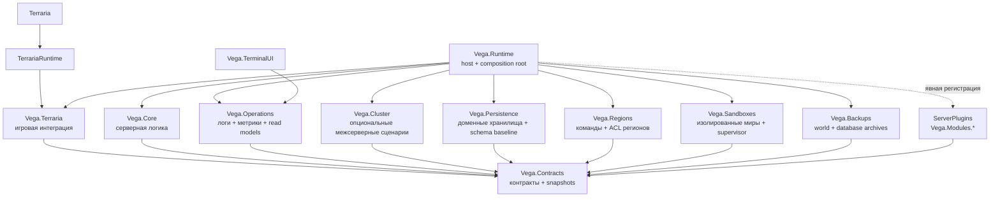

# Vega

<p align="center">
  <strong>Русский</strong>
  · <a href="README_EN.md">English</a>
  · <a href="docs/ru/project-guide.md">Документация</a>
  · <a href="docs/roadmap.md">Roadmap</a>
  · <a href="docs/decisions/">ADR</a>
</p>

Vega — самостоятельный серверный runtime и framework для Terraria на .NET 11 Preview 7. Он запускает Terraria через TerrariaRuntime, отделяет игровую интеграцию от серверной логики и предоставляет типизированные контракты для команд, событий, игроков, пакетов, модулей, операций и кластерных сценариев.

Vega не является форком TShock и не поддерживает бинарную или исходную совместимость с TShock/TSAPI-плагинами. Старые реализации используются только как источник проверенных сценариев, требований и регрессионных тестов.

## Архитектура



`Vega.Core` не зависит от Terraria или TerrariaRuntime. Всё изменяемое игровое состояние остаётся за границей `Vega.Terraria`, а остальные компоненты работают через типизированные контракты и неизменяемые snapshots.

## Что уже есть

- нативный host `Vega.Server` без TSAPI и TShockAPI;
- строгая граница `Vega.Contracts` / `Vega.Core` / `Vega.Terraria` / `Vega.Runtime`;
- типизированные события, команды и packet pipeline на базе `TZ.Multiplicity`;
- безопасные player snapshots и операции через game-thread dispatcher;
- встроенные модули PvP и Custom Items;
- режимы Terminal UI, plain console и headless;
- структурные логи, runtime/GC/network/TPS-метрики и readiness telemetry;
- опциональные типизированные cluster-контракты и reference transport;
- доменное хранение с готовым SQLite и провайдерами PostgreSQL/MySQL;
- экспериментальный `.vworld` cache с безопасным fallback на `.wld`.

## Требования

- .NET SDK 11.0.100-preview.7.26381.103, закреплённый в `global.json`;
- доступ к NuGet при первом восстановлении пакетов;
- совместимая Terraria/TerrariaRuntime server runtime-среда.

## Сборка и тесты

```powershell
dotnet restore Vega.sln
dotnet build Vega.sln --configuration Release --no-restore
dotnet test Vega.sln --configuration Release --no-build --no-restore
```

Публикация готового сервера:

```powershell
dotnet publish src/Vega.Runtime/Vega.Runtime.csproj `
  --configuration Release `
  --output artifacts/server
```

После публикации launcher остаётся в корне, общие зависимости находятся в `libs/`, а встроенные серверные модули — в `ServerPlugins/`.

Горячая замена внешних unload-safe плагинов в `ServerPlugins/` доступна через `IHotReloadableVegaModule`, но выключена по умолчанию в `config/modules.json`. Встроенные `IVegaModule` пересоздаются отдельным поколением через также выключенный по умолчанию `config/soft-restart.json`; Terraria, мир, игроки и БД при этом остаются живы.

## Запуск

```powershell
artifacts/server/Vega.Server.exe --vega-ui=plain
```

Доступные режимы: `auto`, `tui`, `plain`, `headless`. World-image cache включается параметром `--vega-world-image=on` или прямым выбором `-world путь/к/world.vworld`. Ручное и автоматическое сохранение обновляют image. Автосохранение настраивается в `config/world-maintenance.json`; опциональная очистка предметов/снарядов модулем AutoWorldCleaner — в `config/auto-world-cleaner.json`.

## Документация

- [Полное руководство на русском](docs/ru/project-guide.md)
- [English project guide](docs/en/project-guide.md)
- [Архитектура](docs/architecture.md)
- [Operations API и Terminal UI](docs/operations.md)
- [Изолированные sandbox-миры](docs/ru/sandboxes.md)
- [Резервные копии](docs/ru/backups.md)
- [Мягкий перезапуск](docs/ru/soft-restart.md)
- [Cluster messaging](docs/cluster.md)
- [Хранение и провайдеры баз данных](docs/ru/persistence.md)
- [World image](docs/world-images.md)
- [Публикация релизов](docs/releasing.md)
- [Roadmap](docs/roadmap.md)
- [Архитектурные решения](docs/decisions/)

## Статус

Roadmap фиксирует завершённые возможности и переход активной разработки на .NET 11 Preview 7; перевод production-канала по-прежнему требует compatibility-, deployment- и soak-проверок. Dimensions-forwarding, sandbox-процессы, мягкий перезапуск и резервное копирование реализованы, но опасные operational-возможности выключены консервативными настройками. Авторитетный SSC, legacy whitelist/warps и совместимость с TShock REST не входят в цели Vega 1.0.

## Лицензия

Оригинальный код Vega распространяется по проприетарной лицензии [Vega Proprietary License](LICENSE). Публичная доступность репозитория или NuGet-пакета не делает проект open source и не предоставляет права использования, модификации или распространения сверх явно выданного разрешения.

Сторонние зависимости сохраняют лицензии своих правообладателей; см. [licenses/README.md](licenses/README.md).
