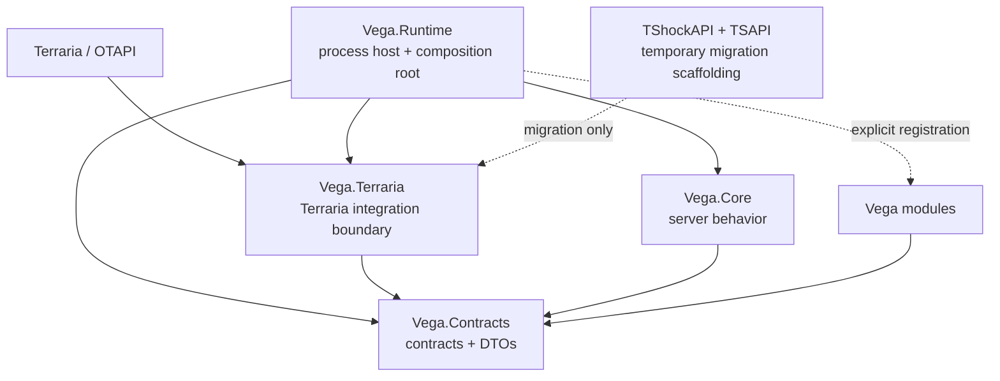

# Vega

<p align="center">
  <a href="README.md"><strong>Русский</strong></a>
  &nbsp;·&nbsp;
  <a href="README_EN.md">English</a>
  &nbsp;·&nbsp;
  <a href="docs/architecture.md">Архитектура</a>
  &nbsp;·&nbsp;
  <a href="docs/roadmap.md">Roadmap</a>
  &nbsp;·&nbsp;
  <a href="docs/decisions/">ADR</a>
</p>

Vega — самостоятельный современный server framework/runtime для Terraria.

Проект вырос из production-опыта TShock, но не рассматривается как TShock с модернизированной внутренней архитектурой. Старый код остаётся источником поведения, edge cases и regression-сценариев, а не архитектурным фундаментом.

## Архитектура



- `Vega.Contracts` — независимые контракты и DTO.
- `Vega.Core` — серверное поведение без Terraria, OTAPI, TSAPI и TShockAPI.
- `Vega.Terraria` — единственное целевое место для Terraria/OTAPI-specific integration.
- `Vega.Runtime` — process host и composition root.
- `TShockAPI` и `external/TSAPI` пока остаются только как migration scaffolding и не являются частью target architecture.

`Vega.Core` защищён architecture test: появление ссылки на Terraria/OTAPI/TShockAPI ломает тесты.

## Сборка

```bash
dotnet restore Vega.sln
dotnet build Vega.sln
dotnet test Vega.sln
```

Основной executable: `src/Vega.Runtime/Vega.Runtime.csproj`, assembly `Vega.Server`.

## Готовность сервера

`NetworkReady` является основной пользовательской точкой готовности. Необязательный warmup выполняется после открытия сервера. Terraria world loading измеряется отдельно от Vega startup overhead.

Подробнее: [`ADR 0017`](docs/decisions/0017-startup-lifecycle-readiness-and-performance-budgets.md).

## Документация

- [`docs/architecture.md`](docs/architecture.md)
- [`docs/roadmap.md`](docs/roadmap.md)
- [`docs/operations.md`](docs/operations.md)
- [`ADR 0016`](docs/decisions/0016-vega-independent-runtime-architecture.md)
- [`ADR 0017`](docs/decisions/0017-startup-lifecycle-readiness-and-performance-budgets.md)

## Лицензия

Оригинальный код Vega является закрытым и распространяется на условиях [`LICENSE`](LICENSE). Все права, прямо не предоставленные владельцем проекта, сохраняются за правообладателем.

Репозиторий пока содержит legacy/migration-код TShock и сторонние компоненты под их собственными лицензиями. Эти лицензии не отменяются закрытой лицензией Vega. Копия GPL-3.0, применимая к унаследованным TShock-файлам, хранится в [`licenses/TShock-GPL-3.0.txt`](licenses/TShock-GPL-3.0.txt).
