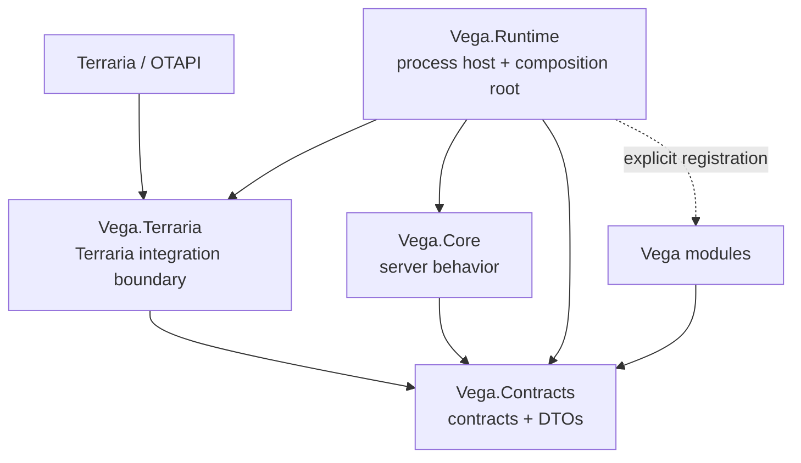

# Vega

<p align="center">
  <a href="README.md">Русский</a>
  &nbsp;·&nbsp;
  <a href="README_EN.md"><strong>English</strong></a>
  &nbsp;·&nbsp;
  <a href="docs/architecture.md">Architecture</a>
  &nbsp;·&nbsp;
  <a href="docs/roadmap.md">Roadmap</a>
  &nbsp;·&nbsp;
  <a href="docs/decisions/">ADRs</a>
</p>

Vega is an independent modern server framework/runtime for Terraria. Historical TShock and TerraZ implementations remain behavioral evidence, not Vega's architectural foundation or copied runtime source.

## Architecture



- `Vega.Contracts` contains implementation-independent contracts and DTOs.
- `Vega.Core` owns server behavior and must not reference Terraria or OTAPI.
- `Vega.Terraria` is the target home for Terraria/OTAPI-specific integration.
- `Vega.Runtime` is the process host and composition root.
TShockAPI and TSAPI have been removed from the runtime, solution and source tree. The Core dependency boundary is enforced by architecture tests.

## Build

```bash
dotnet restore Vega.sln
dotnet build Vega.sln
dotnet test Vega.sln
```

The main executable project is `src/Vega.Runtime/Vega.Runtime.csproj`, producing `Vega.Server`.

## Operations UI

Use `--vega-ui=auto|tui|plain|headless` to select the optional Terminal.Gui dashboard, traditional console mode, or non-interactive service mode. See [`docs/operations.md`](docs/operations.md) for dashboard views, structured logging and command-palette behavior.

## Server readiness

`NetworkReady` is the primary user-facing readiness point. Optional warmup work runs only after the server is open. Terraria world loading is measured separately from Vega startup overhead.

See [`ADR 0017`](docs/decisions/0017-startup-lifecycle-readiness-and-performance-budgets.md).

## Documentation

- [`docs/architecture.md`](docs/architecture.md)
- [`docs/roadmap.md`](docs/roadmap.md)
- [`docs/operations.md`](docs/operations.md)
- [`ADR 0016`](docs/decisions/0016-vega-independent-runtime-architecture.md)
- [`ADR 0017`](docs/decisions/0017-startup-lifecycle-readiness-and-performance-budgets.md)

## License

Original Vega code is proprietary and governed by [`LICENSE`](LICENSE). All rights not expressly granted by the project owner are reserved.

Third-party packages retain the licenses published by their copyright holders; see [`licenses/README.md`](licenses/README.md).
