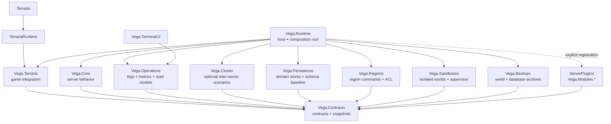

# Vega

<p align="center">
  <a href="README.md">Русский</a>
  · <strong>English</strong>
  · <a href="docs/en/project-guide.md">Documentation</a>
  · <a href="docs/roadmap.md">Roadmap</a>
  · <a href="docs/decisions/">ADRs</a>
</p>

Vega is an independent server framework for Terraria 1.4.6.1 targeting .NET 11. It hosts the patched official dedicated server through TerrariaRuntime 1.1.5, separates game integration from server behavior, and exposes typed contracts for commands, events, players, packets, modules, operations, and cluster scenarios.

Vega is not a TShock fork and does not provide binary or source compatibility for TShock/TSAPI plugins. Historical implementations are used only as evidence for production behavior, requirements, and regression scenarios.

## Architecture



`Vega.Core` has no Terraria or TerrariaRuntime dependency. Mutable game state remains behind the `Vega.Terraria` boundary, while other components use typed contracts and immutable snapshots.

## Available today

- native `Vega.Server` hosting without TSAPI or TShockAPI;
- strict `Vega.Contracts` / `Vega.Core` / `Vega.Terraria` / `Vega.Runtime` boundaries;
- typed events, commands, and a `Multiplicity 4.0.1` packet pipeline (native protocol 329);
- immutable player snapshots and game-thread-dispatched operations;
- built-in PvP and Custom Items modules;
- built-in [FakeProvider SDK](../plugin-sdk.md#plugin-facing-fakeprovider) via `context.World.FakeProvider`, named global/personal tile layers, `fake`/`pfake` commands and entity visibility;
- optional [paged native tile storage](../paged-native-tiles.md) preserving native `ITile` semantics;
- Terminal UI, plain-console, and headless modes;
- structured logs plus runtime, GC, network, TPS, and readiness telemetry;
- optional typed cluster contracts with a reference transport;
- domain persistence with deploy-ready SQLite plus PostgreSQL and MySQL providers;
- an experimental `.vworld` cache with safe `.wld` fallback.

## Requirements

- .NET SDK 11.0.100, pinned by `src/global.json`;
- NuGet access for the initial restore;
- a compatible Terraria/TerrariaRuntime server runtime environment.

## Build and test

```powershell
Push-Location src
dotnet restore Vega.sln
dotnet build Vega.sln --configuration Release --no-restore
dotnet test Vega.sln --configuration Release --no-build --no-restore
Pop-Location
```

Publish a ready-to-run server directory:

```powershell
Push-Location src
dotnet publish Vega.Runtime/Vega.Runtime.csproj `
  --configuration Release `
  --output ../artifacts/server
Pop-Location
```

The launcher stays at the publish root, shared dependencies live in `libs/`, and bundled server modules live in `ServerPlugins/`.

Hot replacement for external unload-safe `IHotReloadableVegaModule` plugins in `ServerPlugins/` is available but disabled by default in `config/modules.json`. Bundled `IVegaModule` instances use the separate, also disabled-by-default `config/soft-restart.json` generation boundary; Terraria, the world, players, and persistence stay alive.

## Run

```powershell
artifacts/server/Vega.Server.exe --vega-ui=plain
```

Supported modes are `auto`, `tui`, `plain`, and `headless`. Enable the world-image cache with `--vega-world-image=on` or directly select it with `-world path/to/world.vworld`. Manual and automatic saves refresh the image. Autosave is configured in `config/world-maintenance.json`; the optional AutoWorldCleaner item/projectile policy is configured in `config/auto-world-cleaner.json`.

## Documentation

- [Complete English project guide](docs/en/project-guide.md)
- [Полное руководство на русском](docs/ru/project-guide.md)
- [Architecture](docs/architecture.md)
- [Operations API and Terminal UI](docs/operations.md)
- [Isolated sandbox worlds](docs/sandboxes.md)
- [Deployment backups](docs/backups.md)
- [In-process soft restart](docs/soft-restart.md)
- [Cluster messaging](docs/cluster.md)
- [Persistence and database providers](docs/persistence.md)
- [World images](docs/world-images.md)
- [Release procedure](docs/releasing.md)
- [Roadmap](docs/roadmap.md)
- [Architecture Decision Records](docs/decisions/)

## Status

The roadmap records completed capabilities and the move to the patched official Terraria 1.4.6.1 server; production promotion remains gated by compatibility, deployment, and soak validation. Dimensions forwarding, sandbox backends, scheduled backups, soft restart, basic whitelist and warps are implemented. Authoritative SSC and full TShock behavior parity remain open. Binary compatibility with TShock is not a goal.

## License

Original Vega code is distributed under the proprietary [Vega Proprietary License](../../licenses/LICENSE). Public access to the repository or a NuGet package does not make Vega open source and grants no use, modification, or redistribution rights beyond an express authorization.

Third-party dependencies retain their respective licenses; see [licenses/README.md](licenses/README.md).
